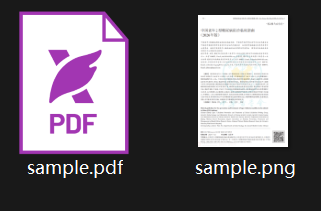
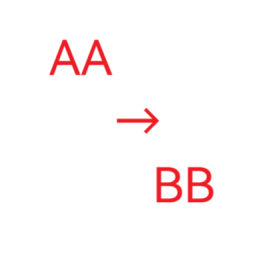

# hspdf

[中文版](README_CN.md)

> **Formerly known as `pdfcpu2`.** The project was renamed to `hspdf` in response to
> [pdfcpu2#1](https://github.com/huzpsb/pdfcpu2/issues/1) — see that issue for the
> background.

hspdf is a fork of [pdfcpu](https://github.com/pdfcpu/pdfcpu) with more features — most
notably offline OCR and PDFBox-compatible text extraction — while retaining the existing
PDF processing commands. It builds as a single static binary, with no Python, cgo, or
external services required.

```sh
hspdf ocr scan.pdf scan_ocr.pdf && hspdf extract -m text scan_ocr.pdf -
```

This adds a searchable text layer to a scanned PDF and extracts the resulting text. The same pipeline can be used for RAG ingestion, agent tools, and batch document processing.

| `hspdf extract -m text`: extract text from a PDF | `hspdf ocr`: add an invisible, selectable text layer to scans |
| --- | --- |
|  |  |

| `hspdf render`: rasterize PDF pages to PNG/JPEG | `hspdf replace`: rewrite text in place |
| --- | --- |
|  |  |

## Documentation

The [project wiki](https://github.com/huzpsb/hspdf/wiki) contains about 60 pages of documentation, including CLI usage, Go API examples, and getting-started guides.

No installation needed? A **browser version** is available at <https://huzpsb.github.io/hspdf/> — the same engine compiled to WebAssembly, processing everything locally in the page. See the [Web UI](https://github.com/huzpsb/hspdf/wiki/Web-UI) wiki page for what it covers.

## Motivation

Horst Rutter, the maintainer of pdfcpu, is a member of the PDF Association. I admire his commitment to the PDF standard. But I genuinely need text extraction, OCR, and related features in my own work. Respect for his work does not remove that need, so I added them here and use them.

## Features

- **Single binary.** The PP-OCRv6 detection and recognition models (about 6 MB) are embedded in the executable. OCR runs offline without API keys, tokens, rate limits, or data leaving the local machine. Windows, Linux, and macOS are supported on amd64 and arm64.
- **Also runs in the browser.** The same engine compiled to WebAssembly powers a local-first web app at <https://huzpsb.github.io/hspdf/> — encrypt/decrypt, OCR, solidify, obfuscate, optimize, text extraction, watermark, split/merge, images→PDF, attachments, signatures, and batch processing run entirely in the page. No file is ever uploaded.
- **Pure Go OCR inference.** The models run on a pure Go engine using fp32 scalar math and goroutine-based parallelism. No cgo, ONNX Runtime, or Python is required.
- **OCR benchmarks.** PaddlePaddle's published benchmark reports the following results for PP-OCRv6 and several general-purpose VLMs:

  

  | Model | Text detection | Text recognition |
  | --- | --- | --- |
  | PP-OCRv6_medium | **86.2** | **83.2** |
  | PP-OCRv6_small | 84.1 | 81.3 |
  | **PP-OCRv6_tiny** (embedded) | 80.6 | 73.5 |
  | Gemini-3.1-Pro | 46.8 | 71.4 |
  | GPT-5.5 | 45.6 | 64.2 |
  | Qwen3-VL-235B | 38.3 | 74.9 |

  Source: [PP-OCRv6 model card](https://www.modelscope.cn/models/PaddlePaddle/PP-OCRv6_small_rec_onnx). The specialized models also have no per-page API cost.
- **PDFBox-compatible text extraction.** `extract -m text` follows Apache PDFBox's default extractor. Behavior has been tuned through differential testing against PDFBox on a corpus of more than 1,200 real-world Chinese PDFs from different periods and generators.
- **Page rendering.** A self-contained pure-Go rasterizer (text including CJK/CID fonts, images, shadings, transparency groups) turns pages into PNG/JPEG images (`render`). `solidify` rebuilds pages as image-only pages to block text copying and content modification, `obfuscate` garbage fills the cmap/ToUnicode mappings of embedded CID fonts to block text extraction while pages keep rendering identically. Text drawn with fonts that are not embedded falls back to the bundled vivo Sans.
- **Text replacement.** `replace` removes every occurrence of a find string from the content streams (page content and Form XObjects, whitespace-insensitive matching) and draws the replacement in place, anchored at the visually topmost-left matched glyph and preserving the original text matrix, font size, spacings, rise, render mode and fill color. Replacement glyphs come from one embedded vivo Sans subset that is reused and extended across runs, so replaced text stays selectable, extractable and copy-pastable; bold originals are approximated with fill+stroke. Output is optimized on write.
- **CJK support.** Text extraction handles ToUnicode CMaps (including Type42 and array-form `bfrange`), embedded TrueType cmaps, legacy GBK/Big5, Adobe-GB1/CNS1 CID fallbacks, and a Latin-1 last resort. The OCR models are trained for Chinese and English.
- **Repeatable OCR.** Processed images are marked, so running `ocr` again only processes new content. Text is added as an invisible layer mapped through each image's page transform, keeping selection aligned with the visible glyphs.
- **CLI and API integration.** Supports stdin/stdout streaming (`-`), page selection, JSON output, and `context.Context` cancellation in the Go API.

## Additional commands

| Feature | Command | Status |
| --- | --- | --- |
| Plain-text extraction (PDFBox-compatible) | `hspdf extract -m text` | Available |
| Invisible OCR text layer for scanned PDFs | `hspdf ocr` | Available |
| Page rendering / rasterization | `hspdf render` | Available |
| Text replacement (embedded vivo Sans subsets) | `hspdf replace` | Available |
| Content freezing (replace page content with its image) | `hspdf solidify` | Available |
| Glyph obfuscation (garbage fill font cmaps and ToUnicode CMaps) | `hspdf obfuscate` | Available |

```sh
# Text extraction
hspdf extract -m text in.pdf out.txt          # whole document
hspdf extract -m text -p 1-3 in.pdf -         # pages 1-3 to stdout

# OCR: make scans searchable and extractable
hspdf ocr scan.pdf scan_ocr.pdf               # all pages
hspdf ocr scan.pdf scan_ocr.pdf -pages 1-10   # selected pages

# Rendering: one image file per page
hspdf render in.pdf outDir                    # PNG at 150 dpi
hspdf render -m jpg -q 90 --dpi 300 in.pdf outDir

# Solidify: rasterize pages and replace their content (anti copy/modify)
hspdf solidify in.pdf out.pdf                 # lossless PNG images
hspdf solidify -m jpg --dpi 200 in.pdf out.pdf

# Obfuscate: garbage fill the font mappings of embedded CID fonts
hspdf obfuscate in.pdf out.pdf                # renders identically, extracts garbage

# Replace text: delete matches, redraw the replacement in place
hspdf replace -f "ACME" -r "CONTOSO" in.pdf out.pdf
hspdf replace -f "DRAFT" in.pdf out.pdf       # empty replacement = delete only
```

As Go code:

```go
conf := model.NewDefaultConfiguration()
ctx := context.Background()

n, err := api.OCRFile(ctx, "scan.pdf", "scan_ocr.pdf", nil, conf) // images processed
err = api.ExtractTextFile(ctx, "scan_ocr.pdf", "out.txt", nil, nil, conf)

// Or extract structured text with line coordinates:
texts, err := api.ExtractText(ctx, rs, []string{"1-3"}, nil, conf) // []pdfcpu.PageText

// Render pages to PNG files:
o := &render.Options{DPI: 150, Format: "png"}
err = api.RenderPagesFile(ctx, "in.pdf", "outDir", nil, o, conf)

// Or replace page content with its rendered image:
err = api.SolidifyFile(ctx, "in.pdf", "out.pdf", nil, o, conf)

// Or garbage fill the text extraction mappings of embedded CID fonts
// (renders identically, extracts garbage):
stats, err := api.ObfuscateFile(ctx, "in.pdf", "out.pdf", conf)

// Or replace text in place (occurrences replaced):
n, err = api.ReplaceTextFile(ctx, "in.pdf", "out.pdf", "ACME", "CONTOSO", nil, conf)
_ = stats // stats.FontFiles, stats.ToUnicode, stats.Skipped
```

## Existing PDF commands

The existing command set remains available, including validation, optimization, merge/split/trim, pages and boxes, stamps and watermarks, forms, encryption, permissions, signatures, attachments, PDF creation, n-up, booklets, and posters.

```sh
hspdf validate in.pdf
hspdf merge out.pdf a.pdf b.pdf
hspdf encrypt --opw owner --upw user in.pdf out.pdf   # AES-256
hspdf stamp add "CONFIDENTIAL" "pos:tr, op:.6" in.pdf out.pdf
```

## Installation

```sh
go install github.com/huzpsb/hspdf/cmd/hspdf@latest
# Or from a checkout:
go mod vendor && go build ./cmd/hspdf
```

As a library:

```sh
go get github.com/huzpsb/hspdf
```

## Relationship with upstream

hspdf is an independently maintained hard fork of pdfcpu, forked from **pdfcpu v0.16.4**
and licensed under Apache 2.0. It is not guaranteed to track upstream releases. Issues
and reasonable feature requests are welcome.

Many files derived from upstream were modified for this fork (module path, new features,
synced upstream security fixes); each modified file carries a `Modified by huzpsb for
hspdf` notice below its original pdfcpu copyright header. Files that are new in this fork
are copyright huzpsb.

Existing behavior and API conventions remain compatible where practical. New code follows the existing package layering: `model` → `pkg/pdfcpu` → `pkg/api` → `pkg/cli`.

Upstream project: [pdfcpu](https://github.com/pdfcpu/pdfcpu).

## License

Apache License 2.0, same as upstream (see [`LICENSE.txt`](LICENSE.txt)). The web app
ships the same license text at
[`webui/static/LICENSE.txt`](webui/static/LICENSE.txt), and release binaries include
`LICENSE.txt` in the downloaded archive.

This software embeds **vivo Sans Light** as the fallback font used for rendering text whose fonts are not embedded in a PDF and as the glyph source for text replacement. vivo Sans is licensed by vivo Mobile Communication Co., Ltd. under the *vivo Sans Font Knowledge Property License Agreement* (see `internal/fallbackfont/vivoSans-LICENSE.txt`): the font must be credited inside this software, may not be modified or redistributed standalone, and the copyright notice and agreement are retained alongside the font. Using hspdf to render documents does not transfer any vivo Sans rights to the output images beyond what that agreement grants for works created with the font.

The embedded Adobe CID-to-Unicode tables are derived from Adobe's UCS2 CMap resources (Adobe BSD-style license; copyright notice retained in the generated file's header).
